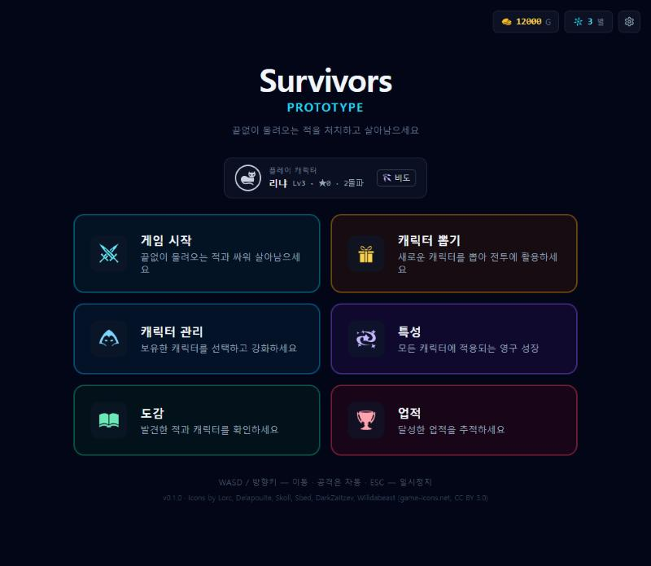
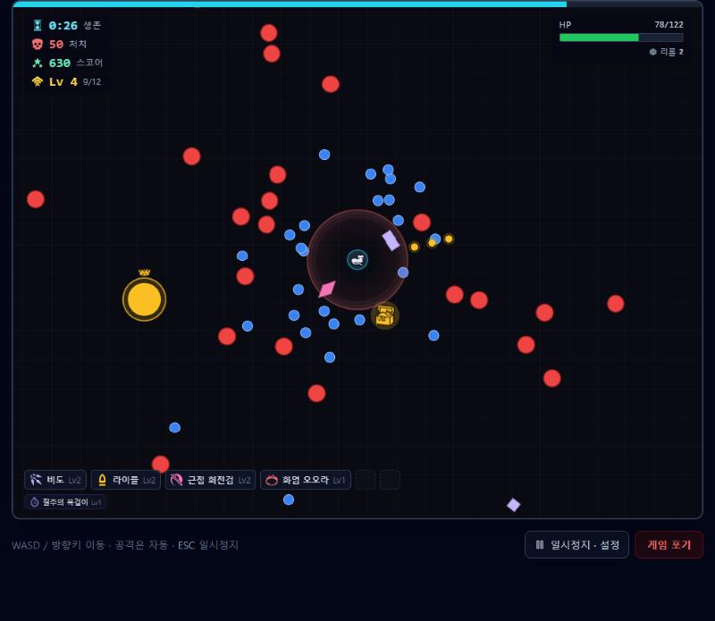
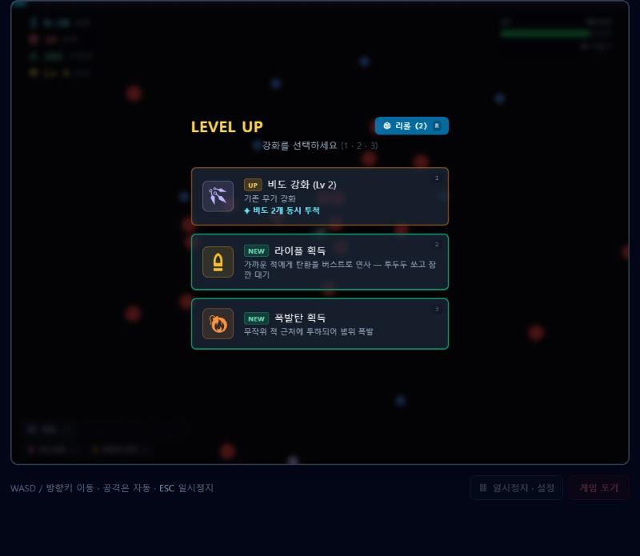
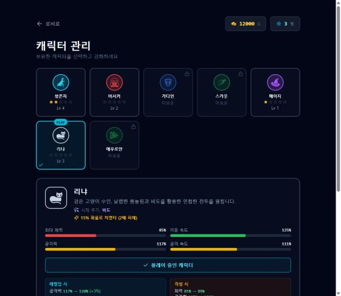

# Survivors Prototype

뱀서라이크(Vampire Survivors-like, "bullet heaven") **브라우저 로그라이트 프로토타입**.
WASD로 움직이기만 하면 무기가 자동으로 공격하고, 경험치를 모아 레벨업할 때마다 무기·장신구를 골라 빌드를 완성한다.
판이 끝나면 골드로 캐릭터 뽑기·강화·특성 같은 영구 성장을 한다.

| 로비 | 인게임 |
|---|---|
|  |  |
| **레벨업** | **캐릭터 관리** |
|  |  |

## 바로 실행

| 방법 | 명령 | 비고 |
|---|---|---|
| **원클릭 exe (Windows)** | `npm run build:exe` → `release/SurvivorsProto.exe` 더블클릭 | 설치 불필요, Edge 앱 창, 세이브는 `%LOCALAPPDATA%\SurvivorsProto\save.json` 에도 백업 |
| 개발 서버 | `npm install` → `npm run dev` → http://localhost:5173 | 코드 수정 시 즉시 반영 |

조작: **WASD / 방향키** 이동 · 공격 자동 · 레벨업 **1/2/3** 선택, **R** 리롤 · **ESC/P** 일시정지(그래픽·효과음 설정)

## 게임 구성

- **무기 7종** — 라이플 · 근접 회전검 · 폭발탄 · 설치형 트랩 · 화염 오오라 · 비도 · 야생의 발톱 (Lv8 + 짝 장신구 → **진화**, 최종형)
- **장신구 9종** — 이동속도·체력·흡수범위·공격력·쿨다운·경험치·반사·피해감소·재생
- **적 7종 + 엘리트** — 시간이 지날수록 새 적 합류, 60초마다 왕관 쓴 엘리트(처치 시 보물 상자 = 추가 레벨업)
- **메타 성장** — 골드 뽑기로 캐릭터 7명 수집, 레벨/각성(별)/돌파(기억), 특성 7종, 진화 업적과 특수 캐릭터 해금

상세 규칙·수치는 [wiki/specs](wiki/specs/README.md) (수치표는 코드에서 자동 생성).

## 기술

React 18 · TypeScript 5 · Vite 5 · Tailwind CSS 3 · Canvas 2D (엔진은 React와 독립)
아이콘: game-icons.net (CC BY 3.0) · 이펙트/후보 에셋: Kenney (CC0) — [CREDITS](wiki/design/assets/CREDITS.md)
원클릭 실행기: C# (Windows 기본 .NET Framework 4 `csc.exe`로 빌드, 추가 설치 없음)

저사양 원칙: 60fps 상한, 일시정지 중 재렌더 없음, shadowBlur·매 프레임 그라디언트 없음, 자동 저사양 모드.

## 명령어

| 명령 | 하는 일 |
|---|---|
| `npm run dev` | 개발 서버 |
| `npm run check` | 타입체크 + 린트 + 헤드리스 시뮬레이션 + 빌드 (커밋 전 필수) |
| `npm run sim` | 헤드리스 게임플레이 회귀 테스트 |
| `npm run docs:spec` | `wiki/specs/generated/*.md` 수치표 재생성 |
| `npm run build:exe` | 웹 빌드 + `release/SurvivorsProto.exe` 생성 (Windows) |

## 디렉토리

```
.
├─ AGENTS.md        ← AI 에이전트 작업 지침 (사람도 먼저 읽을 것)
├─ CHANGELOG.md
├─ src/             ← 게임 소스 (game: 순수 로직 / ui: React 화면 / assets: 아이콘·이펙트)
├─ public/          ← 런타임 정적 에셋 (늑대 스프라이트 등)
├─ launcher/        ← 원클릭 exe 실행기 (C#)
├─ scripts/         ← exe 빌드 · 수치표 생성 · 헤드리스 시뮬레이션
└─ wiki/            ← 개발 위키 (개요·원작자 의도 대조 / 명세 / 레퍼런스 / 방법론 / 커뮤니티 / 방향성 / 디자인)
```

## 출처

- 원본: Bolt.new 로 생성된 프로토타입 — [wiki/overview](wiki/overview/project-history.md), 원작자 의도 대조: [original-intent-audit](wiki/overview/original-intent-audit.md)
- `public/assets/` 의 늑대·발톱 이미지는 원본 프로젝트에 포함되어 있던 파일로, 출처·라이선스 확인이 필요하다.
